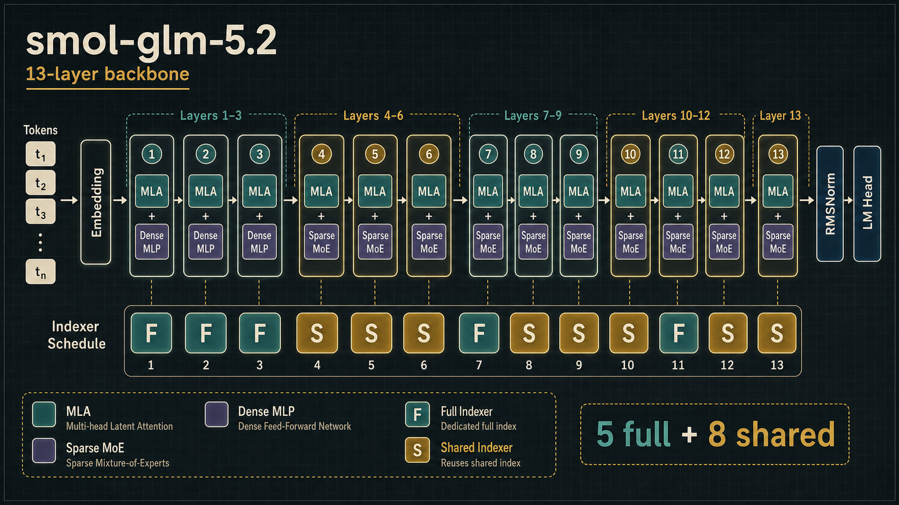
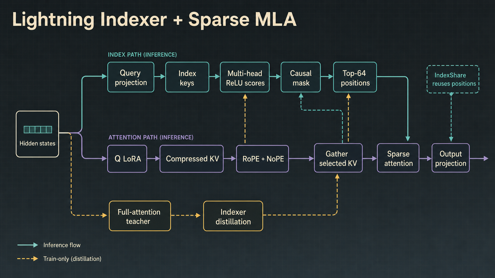
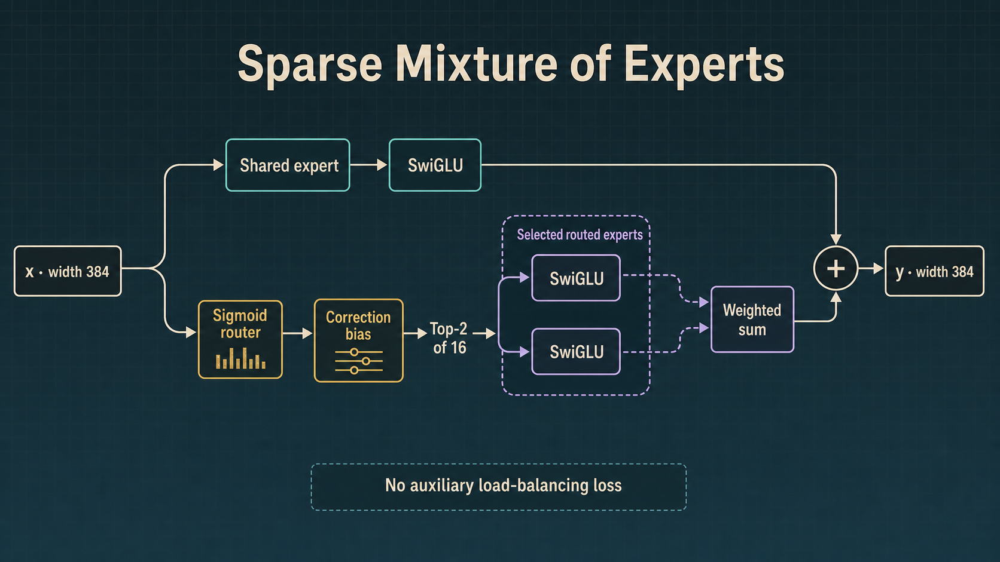
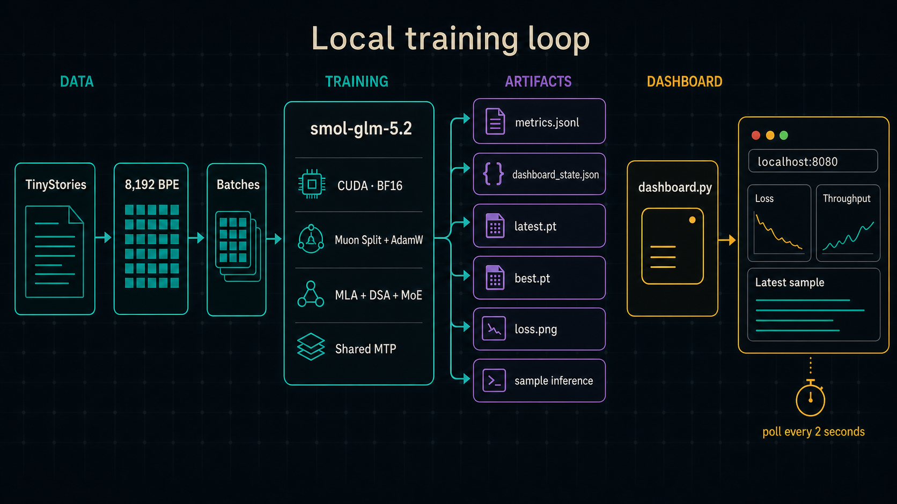

<div align="center">

# smol-glm-5.2

### A 50.15M-parameter, GLM-5.2-inspired language model for one consumer GPU

[](#model-card)
[](#model-card)
[](https://pytorch.org/)
[](https://huggingface.co/datasets/roneneldan/TinyStories)
[](#verification)

**MLA · DSA · Lightning Indexer · IndexShare · Sparse MoE · Shared MTP · Muon Split**

[Quick start](#quick-start) · [Architecture](#architecture) · [Dashboard](#live-training-dashboard) · [Model card](#model-card) · [Verification](#verification)

</div>

---

`smol-glm-5.2` is a readable, training-oriented miniature of the public
GLM-5/GLM-5.2 language-model architecture. It compresses the defining ideas
of a 753B-parameter sparse frontier model into **50,153,344 trainable
parameters**, with approximately **21,768,064 parameters active for each
token**, and trains from scratch on TinyStories.

This repository keeps the interesting machinery instead of quietly replacing
it with a standard dense Transformer:

- low-rank Multi-head Latent Attention with separate RoPE and NoPE channels;
- DeepSeek Sparse Attention driven by a trainable multi-head lightning indexer;
- the public GLM-5.2 `FFFSSSFSSSFSS` IndexShare schedule;
- detached full-attention teachers and multi-layer indexer distillation;
- three dense feed-forward layers followed by ten sparse MoE layers;
- sigmoid top-k routing with a correction bias and no auxiliary balancing loss;
- one parameter-shared multi-token predictor unrolled across three depths;
- Muon Split for matrices and AdamW for embeddings, norms, and scalars;
- compressed-KV cached decoding, atomic checkpoints, and a live local dashboard.

This is an **architecture study**, not a claim that 50M parameters reproduce
the reasoning, coding, agentic, multilingual, or long-context capabilities of
the full GLM-5.2 release. The goal is to make the mechanisms small enough to
read, run, instrument, and modify on one machine.

> [!NOTE]
> CUDA training uses BF16 autocast. Mask values, sparse-MoE accumulation, and
> indexer distillation are explicitly BF16-safe and covered by a forward/
> backward regression test.

## Why this exists

Frontier MoE reports are fascinating but difficult to turn into a local
experiment. A conventional tiny Transformer answers a different question:
"can a small decoder learn TinyStories?" This project asks:

> What does the GLM-5.2 data flow look like when its architectural choices are
> preserved but its widths, expert counts, layer count, vocabulary, and
> context are scaled down to local-training size?

The result is intentionally plain PyTorch. There are no custom CUDA kernels,
distributed expert-parallel collectives, or opaque training frameworks between
the reader and the model.

## Architecture

### 1. Thirteen-layer backbone

The authoritative shape lives in
[`configs/glm52_50m.json`](configs/glm52_50m.json). Every decoder layer uses
MLA; layers 1–3 use dense SwiGLU MLPs, while layers 4–13 use sparse
mixture-of-experts blocks.

<p align="center">
  
</p>

`F` means the layer owns a full lightning indexer. `S` means the layer reuses
the most recent full indexer's selected token positions:

```text
layer          01 02 03 04 05 06 07 08 09 10 11 12 13
indexer        F  F  F  S  S  S  F  S  S  S  F  S  S
feed-forward   D  D  D  M  M  M  M  M  M  M  M  M  M
```

That is **five retained indexers and eight shared-indexer layers**. The first
three full indexers preserve the public schedule's offset before the repeating
`FSSS` rhythm.

### 2. Multi-head Latent Attention

The attention path follows the main ideas of DeepSeek-style MLA:

1. The query is compressed to a rank-128 latent, normalized, and expanded into
   six heads.
2. Keys and values share a rank-64 compressed latent.
3. Query/key channels split into 48 NoPE dimensions and 16 RoPE dimensions.
4. The rotary key is stored separately from the compressed KV latent.
5. Only the indexer's selected causal positions participate in the final
   attention softmax.

For autoregressive decoding, each layer caches compressed latent KV and rotary
keys. Full-indexer layers additionally cache their index keys. Shared-indexer
layers reuse selection and do not allocate duplicate index-key caches.

### 3. Lightning indexer, DSA, and IndexShare

<p align="center">
  
</p>

Each retained indexer projects a low-rank query into four 32-dimensional
heads, scores normalized index keys with ReLU similarities, then learns a
token-dependent head weighting. A hard causal mask is applied before selecting
the top 64 positions.

During training, the regular MLA scores also produce a detached full-attention
teacher distribution. One retained indexer is supervised by every attention
layer that consumes its selection. The targets are averaged before
cross-entropy:

```text
retained indexer → its own teacher + teachers from following shared layers
                 → averaged target distribution
                 → indexer cross-entropy
```

At a sequence length of 256, the first 64 positions naturally attend to every
available causal token; later positions use a true top-64 subset. The
lightning indexer itself still computes dense scores, so this eager
implementation demonstrates the architecture rather than claiming a
production long-context speedup.

### 4. Sparse mixture of experts

<p align="center">
  
</p>

The final ten decoder layers contain:

- **16 routed experts**, of which the top two run for each token;
- **one always-on shared expert**;
- 176 hidden units per expert;
- sigmoid router scores normalized only across the selected experts;
- a routing correction bias updated from exact local-batch quantiles.

The correction bias affects expert selection but not mixture weights. This
keeps routing auxiliary-loss-free while nudging expert usage toward balance.
At local batch sizes, exact quantiles are simpler and more readable than the
distributed histogram approximation used by frontier-scale systems.

Expert contributions are accumulated in the residual stream's dtype. Under
BF16 autocast, expert outputs are promoted into the FP32 accumulator before
`index_add_`, avoiding mixed-dtype failures and preserving stable summation.

### 5. Shared multi-token prediction

One auxiliary predictor is reused at every future-token depth:

```text
backbone state + known future-token embedding
             ↓ normalize, concatenate, fuse
       causal attention + SwiGLU
             ↓
      predict token at depth d
             ↓ reuse the same predictor
      predict depths 1, 2, and 3
```

The predictor parameters are shared across all three depths. This adds a
training-only signal for future-token structure without tripling the auxiliary
module size. Normal generation uses the backbone LM head and does not execute
the MTP loss path.

### 6. Optimizer split

Two optimizers advance together:

| Parameter family | Optimizer | Default LR | Weight decay |
|---|---|---:|---:|
| Matrix parameters except embeddings/LM head | Muon | `1e-2` | `0.1` |
| Token embeddings and LM head | AdamW | `3e-4` | `0.1` |
| Norm weights, biases, and scalars | AdamW | `3e-4` | `0.0` |

Muon uses five Newton–Schulz steps to approximate the matrix polar factor.
Query, KV, MTP-attention, and indexer projections carry per-head metadata so
their updates are orthogonalized head by head instead of as one flattened
matrix. Router correction biases are non-parameter state updated directly from
the current batch's score quantiles.

## What was scaled—and what was not

| Component | Public GLM-5.2 | smol-glm-5.2 |
|---|---:|---:|
| Total parameters | ~753B | **50,153,344** |
| Active parameters | ~40B | **~21,768,064** |
| Decoder layers | 78 | **13** |
| Hidden size | 6,144 | **384** |
| Attention heads | 64 | **6** |
| Q LoRA rank | 2,048 | **128** |
| KV LoRA rank | 512 | **64** |
| QK dimensions | 192 NoPE + 64 RoPE | **48 NoPE + 16 RoPE** |
| Value head dimension | 256 | **64** |
| Indexer heads / head size | 32 / 128 | **4 / 32** |
| Sparse top-k | 2,048 | **64** |
| Indexer pattern | `FFFSSS(FSSS)…` | **`FFFSSSFSSSFSS`** |
| Dense MLP layers | first 3 | **first 3** |
| Routed experts | 256, Top-8 | **16, Top-2** |
| Shared experts | 1 | **1** |
| MTP | shared auxiliary predictor | **shared across 3 depths** |
| Vocabulary | 154,880 | **8,192 BPE** |
| Word embeddings | untied | **untied** |
| Release context | up to 1M | **256 training default** |
| Training corpus | frontier mixture | **TinyStories** |

The scale changes are deliberate. The attention factorization, causal sparse
selection, index-sharing rhythm, router semantics, MTP parameter sharing, and
optimizer partition remain visible in code. Production FP8 indexer kernels,
expert parallelism, distributed training, reinforcement learning, and agentic
post-training are outside this repository's scope.

## Model card

| Field | Value |
|---|---:|
| Model name | `smol-glm-5.2` |
| Task | decoder-only causal language modeling |
| Trainable parameters | **50,153,344** |
| Approx. active parameters/token | **21,768,064** |
| Layers | 13 |
| Hidden size | 384 |
| Attention heads | 6 |
| Q/K head size | 64 |
| Value head size | 64 |
| Dense / MoE layers | 3 / 10 |
| Routed experts | 16, Top-2 |
| Shared experts | 1 |
| Indexers | 5 full, 8 shared |
| Sparse attention | causal Top-64 |
| MTP depth | 3, parameter-shared |
| Vocabulary | 8,192 byte-level BPE |
| Embeddings | untied |
| RoPE theta | 8,000,000 |
| Default sequence length | 256 |
| Default effective token batch | 8,192 |
| Precision | CUDA BF16 autocast |
| Optimizer | Muon Split + AdamW |
| Initialization | normal, σ = 0.02 |
| Training dataset | TinyStories |

### Training objective

The total objective is:

```text
L = L(next-token)
  + 0.10 × mean[L(shared MTP depth 1..3)]
  + 0.02 × mean[L(indexer distillation groups)]
```

`L(next-token)` and MTP use cross-entropy with `-100` ignored. Indexer targets
are detached full-attention distributions. Masked causal positions are removed
from the distillation product explicitly, keeping the hard `-inf` attention
mask without introducing `0 × -inf` NaNs.

## Quick start

Run all commands from the repository root.

### 1. Clone and install

```bash
git clone https://github.com/cneuralnetwork/smol-glm-5.2.git
cd smol-glm-5.2
python3 -m pip install -r requirements.txt
```

Python 3.10+ and PyTorch 2.5+ are recommended. Full training expects a
CUDA-capable GPU; the smoke configuration also runs on CPU.

### 2. Prepare TinyStories

Create the full training split, 10,000-story validation split, and an
8,192-token byte-level BPE tokenizer:

```bash
python3 scripts/prepare_tinystories.py \
  --output-dir data/tinystories
```

The prepared representation is deliberately simple:

```text
data/tinystories/
├── metadata.json
├── tokenizer.json
├── train.bin
└── validation.bin
```

Token IDs are stored consecutively as `uint16`; stories are separated by the
`<eos>` token. The trainer memory-maps both binary shards instead of loading
the corpus into RAM.

For a quick pipeline fixture:

```bash
python3 scripts/prepare_tinystories.py \
  --output-dir data/tinystories-smoke \
  --tokenizer-stories 10000 \
  --train-stories 10000 \
  --validation-stories 1000
```

### 3. Start the dashboard

In terminal A:

```bash
python3 dashboard.py \
  --run-dir checkpoints/glm52-50m \
  --port 8080
```

Open **[http://127.0.0.1:8080](http://127.0.0.1:8080)**. The page displays a
waiting state until the trainer creates its first run artifacts.

### 4. Train

In terminal B:

```bash
python3 train.py
```

The command expands to:

```bash
python3 train.py \
  --config configs/glm52_50m.json \
  --data-dir data/tinystories \
  --output-dir checkpoints/glm52-50m \
  --steps 10000 \
  --batch-size 16 \
  --gradient-accumulation 2 \
  --sequence-length 256
```

Default training behavior:

```text
micro-batch             16 sequences
sequence length         256 tokens
gradient accumulation   2
effective token batch   8,192 tokens
warmup                  1%
schedule                cosine to 10% of base LR
gradient clipping       global norm 1.0
evaluation              every 250 steps
checkpointing           every 250 steps
sample generation       every 250 steps
```

At startup, the model reports:

```text
parameters: 50,153,344 total / 21,768,064 active per token
architecture: 13 layers, 5 full indexers, 8 shared indexers
```

Memory use depends on GPU architecture, CUDA/PyTorch versions, allocator
state, and other desktop processes. If the default micro-batch is too large,
preserve the 8,192-token effective batch with:

```bash
python3 train.py \
  --batch-size 8 \
  --gradient-accumulation 4
```

For a lower-memory experiment, reduce both micro-batch and sequence length:

```bash
python3 train.py \
  --batch-size 4 \
  --gradient-accumulation 8 \
  --sequence-length 128
```

### Resume training

`latest.pt` includes model weights, both optimizer states, best validation
loss, training arguments, and Python/NumPy/PyTorch/CUDA RNG state.

```bash
python3 train.py \
  --resume checkpoints/glm52-50m/latest.pt
```

`--steps` is the final target step count, not the number of additional steps.
For example, resuming a step-4,999 checkpoint with `--steps 10000` continues
through step 9,999.

`SIGTERM` and `Ctrl+C` preserve `latest.pt` after the most recently completed
optimizer step. Checkpoints are written to a temporary path and atomically
renamed to avoid exposing half-written files.

### Generate text

From a training checkpoint:

```bash
python3 generate.py checkpoints/glm52-50m/best.pt \
  --prompt "Once upon a time, a little fox" \
  --tokens 200 \
  --temperature 0.8 \
  --top-k 50
```

Generation automatically uses CUDA when available and falls back to CPU.
Token-by-token decoding carries compressed MLA caches and current IndexShare
selections across layers.

### Export SafeTensors

```bash
python3 scripts/export_model.py checkpoints/glm52-50m/best.pt \
  --dashboard-state checkpoints/glm52-50m/dashboard_state.json
```

The default export directory is `release/smol-glm-5.2-tinystories/`:

| File | Purpose |
|---|---|
| `model.safetensors` | BF16 inference weights |
| `config.json` | exact architecture configuration |
| `tokenizer.json` | 8,192-token TinyStories BPE |
| `training_metadata.json` | step, validation loss, run settings, parameter counts |
| `sha256sums.txt` | integrity checksum for every bundle artifact |

Load the exported bundle:

```bash
python3 generate.py release/smol-glm-5.2-tinystories/model.safetensors \
  --prompt "Once upon a time"
```

No pretrained weights are committed to this repository. `checkpoints/`,
`release/`, and prepared binary data are ignored by Git.

## Live training dashboard

The monitoring stack intentionally follows a durable, dependency-light model:
the trainer owns the artifacts and the browser only polls them.

<p align="center">
  
</p>

```text
train.py
  ├── metrics.jsonl             append-only train/validation history
  ├── dashboard_state.json      latest atomic state snapshot
  ├── loss.png                  Matplotlib-rendered loss chart
  ├── latest.pt                 resumable checkpoint
  └── best.pt                   best validation checkpoint
             ↓
dashboard.py → /api/state + /artifacts/loss.png
             ↓
browser polls every two seconds
```

The dashboard shows:

- run status, current step, progress, elapsed time, and ETA;
- total objective, next-token loss, validation loss, MTP loss, and indexer loss;
- token throughput, tokens processed, peak allocated VRAM, gradient norm, and
  current learning-rate scale;
- total versus active parameters, layer counts, IndexShare structure, expert
  count, experts per token, and MTP depth;
- the current loss plot and most recent cached generation sample.

Use `--sample-interval`, `--sample-tokens`, and `--sample-prompt` to control
dashboard samples. Use `--skip-samples` when measuring pure training
throughput.

## Verification

Run the full suite:

```bash
python3 -m pytest -q
```

Expected result:

```text
8 passed
```

The tests cover:

1. the exact `FFFSSSFSSSFSS` IndexShare and dense/MoE schedules;
2. the exact 50,153,344 parameter budget and active-path estimate;
3. forward, backward, next-token, MTP, and indexer-distillation losses;
4. nonzero indexer gradients and router correction-bias behavior;
5. BF16-autocast forward/backward with finite loss and gradients;
6. causal invariance under sparse top-k selection;
7. cached token-by-token decoding against full-sequence logits;
8. dashboard JSONL/state/plot output and SafeTensors inference round-trip.

The exact 50M configuration has also completed a finite BF16-autocast
forward/backward pass, and the combined Muon + AdamW optimizer path has
completed a finite update.

Run lint:

```bash
python3 -m ruff check .
```

Run a one-step CPU pipeline smoke test:

```bash
python3 train.py \
  --config configs/glm52_smoke.json \
  --data-dir data/tinystories-smoke \
  --output-dir /tmp/smol-glm52-smoke \
  --steps 1 \
  --batch-size 1 \
  --gradient-accumulation 1 \
  --sequence-length 8 \
  --eval-batches 1 \
  --skip-samples \
  --device cpu
```

The smoke path produces `best.pt`, `latest.pt`, `metrics.jsonl`,
`dashboard_state.json`, and `loss.png`.

## Troubleshooting

### CUDA is not available

The default 50M run intentionally requires CUDA. Use `--device cpu` only with
the smoke configuration or another substantially reduced experiment:

```bash
python3 train.py \
  --config configs/glm52_smoke.json \
  --data-dir data/tinystories-smoke \
  --device cpu
```

### CUDA out of memory

Reduce `--batch-size`, increase `--gradient-accumulation`, close other GPU
applications, or shorten `--sequence-length`. Gradient checkpointing and
production fused sparse-attention kernels are not implemented.

### Dataset or tokenizer not found

Run the preparation command from the repository root. The model configuration
and tokenizer must have matching vocabulary sizes:

```bash
python3 scripts/prepare_tinystories.py --output-dir data/tinystories
```

### BF16 mask overflow or mixed-dtype accumulation

Current code uses `-inf` for the lightning indexer's hard causal mask, promotes
BF16 expert contributions into the residual accumulator, and excludes masked
positions from indexer distillation. If an older checkout reports
`value cannot be converted to type c10::BFloat16 without overflow`, update to
the latest commit.

### Dashboard says waiting

The dashboard can start before training. It switches from `waiting` when
`train.py` writes `dashboard_state.json` into the same `--run-dir`.

## Repository map

```text
smol-glm-5.2/
├── assets/
│   └── diagrams/
│       ├── backbone.png
│       ├── lightning-indexer.png
│       ├── sparse-moe.png
│       └── training-dashboard.png
├── configs/
│   ├── glm52_50m.json          # authoritative 50.15M shape
│   └── glm52_smoke.json        # tiny CPU pipeline fixture
├── dashboard/
│   ├── app.js                  # two-second state polling
│   ├── index.html
│   └── styles.css
├── data/
│   └── README.md               # prepared-corpus format
├── glm52/
│   ├── __init__.py
│   ├── config.py               # shape + layer schedules
│   ├── model.py                # MLA, DSA, IndexShare, MoE, MTP, decoding
│   ├── monitoring.py           # JSONL/state/Matplotlib artifacts
│   └── optim.py                # Muon, per-head Muon, AdamW split
├── scripts/
│   ├── export_model.py         # BF16 SafeTensors release bundle
│   └── prepare_tinystories.py  # tokenizer + uint16 memmaps
├── tests/
│   └── test_model.py
├── dashboard.py                # local HTTP server
├── generate.py                 # checkpoint/SafeTensors inference
├── train.py                    # single-device training loop
├── pyproject.toml
└── requirements.txt
```

## Design notes

- **Readable first:** attention, routing, distillation, caching, and optimizer
  logic are ordinary PyTorch operations.
- **Pre-norm residual stream:** RMSNorm precedes both attention and
  feed-forward sublayers.
- **Sparse attention:** the main attention softmax is restricted to selected
  positions; the indexer score computation remains dense.
- **IndexShare:** only `F` layers own indexer parameters and caches; `S` layers
  consume the current selection.
- **Distillation:** teacher probabilities are detached, averaged across a
  sharing group, and applied only to causally valid positions.
- **Routing:** correction biases influence selection but never routed mixture
  weights.
- **Active parameters:** the reported estimate counts shared parameters and
  only two routed experts per MoE layer.
- **BF16 stability:** sensitive scores, softmaxes, router math, RMS statistics,
  and Muon Newton–Schulz iterations use FP32 where appropriate.
- **Checkpoint safety:** writes are temporary-file-plus-rename; RNG state is
  included for reproducible continuation.
- **Inference:** decoding caches compressed KV state and index keys rather than
  recomputing the full prefix.

## Scope and limitations

- TinyStories supports base language-model pretraining, not instruction
  following or tool use.
- The model has not inherited knowledge from upstream GLM weights; it starts
  from random initialization.
- Top-64 sparsity at context 256 is primarily an architectural demonstration.
- This repository does not implement FP8 indexer kernels, FlashMLA,
  expert-parallel dispatch, tensor/pipeline parallelism, distributed
  checkpointing, speculative decoding, RL, or agentic post-training.
- Generated diagrams explain this implementation and are not official Zhipu
  AI architecture figures.

## References and acknowledgements

The implementation is derived from publicly documented ideas in:

- the [GLM-5 technical report](https://arxiv.org/abs/2602.15763);
- the public
  [GLM-5.2 configuration](https://huggingface.co/zai-org/GLM-5.2/raw/main/config.json);
- the [IndexCache/IndexShare paper](https://arxiv.org/abs/2603.12201);
- the [DeepSeek-V3 technical report](https://arxiv.org/abs/2412.19437) for
  MLA and auxiliary-loss-free sparse routing;
- the [DeepSeek-V3.2 report](https://arxiv.org/abs/2512.02556) for DeepSeek
  Sparse Attention;
- the [Muon optimizer](https://kellerjordan.github.io/posts/muon/) and its
  Newton–Schulz orthogonalization approach;
- the [TinyStories dataset](https://huggingface.co/datasets/roneneldan/TinyStories).

Please use the upstream reports, model cards, and repositories as the
authoritative sources for their architectures, licenses, and claims.

---

<div align="center">

**Frontier architecture, local scale.**

</div>
